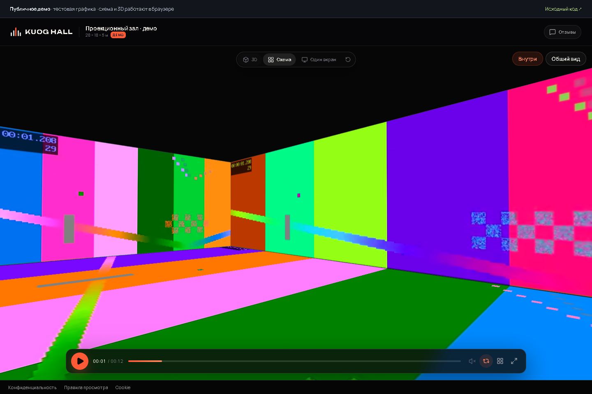

# KUOG HALL — версия 1.1

**[Открыть демо на GitHub Pages](https://negativii.github.io/hall5/)** · [Исходный код](https://github.com/Negativii/hall5)

На GitHub Pages работает отдельное публичное демо: пять синтетических видеоканалов, синхронный таймлайн, схема, одиночный экран и 3D-зал. Оно не содержит закрытых проектов и не обращается к API. Кабинет, загрузки, пароли и отзывы требуют серверной версии; инструкция её запуска приведена ниже.



Локальная версия с конструктором сцены, импортом GLB и безопасной заменой видео. Простой запуск: `Запустить HALL5.command` на Mac или `Запустить HALL5.cmd` на Windows. При первом запуске создаётся `.env` с новым паролем администратора и портом 3100.

Пятиканальный previs для проекционного зала 20 × 10 × 5 м. Четыре стены и пол собираются в один синхронный показ: контент загружается в кабинет, проверяется на схеме и в 3D, а заказчику отправляется одна ссылка без установки и регистрации.

Главная страница показывает только закрытый вход и правовые документы; материалы проектов доступны после ввода пароля.

## Что умеет

- **Конструктор сцены.** Помещение с размерами, экраны, стены, пол, подиумы, столы, стулья и блоки; перемещение, поворот и масштаб мышью, точные поля, undo/redo и восстановление черновика. Импорт GLB со встроенными текстурами до 50 МБ.
- **Пять поверхностей и один таймлайн.** Плей, пауза и перемотка применяются ко всем видео одновременно. Расхождение хронометража видно до премьеры.
- **Сцены показа.** В одном проекте можно создать именованные комплекты видео: заставку, представление, награждение, финал. Расстановка зала и библиотека мебели общие. Заказчик переключает опубликованные сцены по одной ссылке; комментарии и согласование относятся к выбранной сцене.
- **Загрузка с проверкой.** Для каждой поверхности свой формат: 4 800 × 1 200, 2 400 × 1 200 и 4 800 × 2 400. Сервер читает файл через ffprobe, показывает реальное разрешение и предупреждает, если пропорции не совпадают.
- **Видео полного разрешения.** Совместимый H.264 SDR 8-bit 4:2:0 переносится в MP4 с faststart без повторного сжатия видеопотока. Для других SDR-форматов создаётся H.264-копия CRF16 без уменьшения разрешения и частоты кадров; это качественное перекодирование, а не lossless. Исходный файл сохраняется. HDR требует отдельно подготовленной SDR-версии, автоматического изменения цвета нет.
- **Лёгкий просмотр.** «Смотреть по одному экрану» открывает выбранный ролик напрямую средствами браузера в том же качестве. Остальные декодеры освобождаются, 3D засыпает. При возврате в зал все дорожки выравниваются по текущему времени.
- **Обзор на телефоне.** Для одновременного просмотра зала используются отдельные H.264-копии до 1920×1080 с сохранением пропорций и частоты кадров. Это сжатые мобильные версии; полное качество доступно в «Один экран» и на компьютере. Оригиналы сохраняются.
- **3D-зал и схема.** Можно зайти внутрь комнаты и осмотреться или увидеть все пять поверхностей на плоской схеме с точными пропорциями. Любую поверхность можно развернуть на весь экран.
- **Ссылка для заказчика.** Показ открывается в браузере, с обязательным паролем и необязательной датой окончания доступа. Ссылку можно отозвать и выпустить новую.
- **Отзывы и согласование.** Заказчик оставляет замечания на таймкоде и нажимает «Согласовать». Всё это появляется у администратора в проекте.
- **QR-код и мобильный вид.** Ссылку можно отдать с экрана, распечатать или отправить в мессенджер.


## Быстрый старт

Нужен **Node.js 22.12+** (проверено на 24) и npm. ffmpeg и ffprobe ставятся вместе с зависимостями (`ffmpeg-static`, `@ffprobe-installer/ffprobe`).

```bash
cp .env.example .env        # Windows: copy .env.example .env
npm install
npm run dev
```

Если npm заблокировал установочный скрипт `ffmpeg-static` (в некоторых окружениях это происходит), выполните один раз:

```bash
npm run setup:ffmpeg
```

Или поставьте системный ffmpeg — сервер умеет использовать его, если статический бинарник не найден.

Откройте <http://localhost:3000>. Задайте в `.env` собственный `ADMIN_PASSWORD` длиной минимум 12 символов. Пароля по умолчанию нет; без настройки вход заблокирован.

Если порт 3000 занят: `PORT=3100 npm run dev` (PowerShell: `$env:PORT=3100; npm run dev`), затем откройте <http://localhost:3100>.

Демо-показ уже лежит в папке `data`. Сначала задайте ему пароль в кабинете; ссылка показа: <http://localhost:3000/s/demo>. Если папки `data` нет, создайте демо командой:

```bash
npm run seed
```

Сборка и запуск в продакшен-режиме:

```bash
npm run build
npm start
```

`npm start` отдаёт собранный фронтенд и API с одного порта.

## Переменные окружения

| Переменная | По умолчанию | Зачем |
|---|---|---|
| `ADMIN_PASSWORD` | — | Обязательный пароль команды, минимум 12 символов. |
| `PORT` | `3000` | Порт приложения. |
| `HOST` | `0.0.0.0` | Адрес прослушивания. |
| `DATA_DIR` | `./data` | Видео, постеры, `db.json`, секрет сессий. |
| `MAX_UPLOAD_GB` | `8` | Максимальный размер одного файла. |
| `PUBLIC_URL` | — | Публичный адрес сайта для логов и QR (ссылки строятся от текущего домена). |
| `SESSION_SECRET` | генерируется в `data/secret.key` | Ключ подписи cookies и ссылок на медиа. |

## Как этим пользоваться

1. **Создайте показ** в кабинете: название, заказчик, дата.
2. **Создайте сцену показа** кнопкой «Добавить сцену» или выберите основную. Дайте ей понятное заказчику название.
3. **Загрузите видео** в карточки экранов выбранной сцены. Дождитесь готовности всех используемых каналов и нажмите «Опубликовать сцену». До публикации заказчик продолжает видеть предыдущий комплект; новые сцены остаются черновиками.
4. **Проверьте стыки** на схеме или в 3D. Кнопка «Смотреть» на карточке поверхности открывает её отдельно.
5. **Настройте общую ссылку**: пароль, срок действия, отзывы, скачивание оригиналов. Скопируйте ссылку или QR.
6. **Отправьте заказчику.** Он выбирает сцену по названию, оставляет замечания на её таймкоде и согласовывает её. Новая публикация видео сбрасывает согласование только этой сцены. Изменение общей расстановки требует повторного согласования всех сцен.

На клиентской странице загружается только выбранный комплект видео. При переключении предыдущие видеодекодеры освобождаются, новая сцена начинается с нуля. Мобильные копии готовятся автоматически для каждого загруженного ролика.

Текущий показ старого проекта доступен как «Основная сцена», без переноса мебели или повторной загрузки файлов. Основную сцену можно переименовать; удаление дополнительных сцен не меняет расстановку. Старые API загрузки остаются совместимыми, а интерфейс сцен использует отдельную публикацию целого комплекта.

### Поверхности

| # | Обозначение | Размер | Пропорции | Физически |
|---|---|---|---|---|
| 1 | RIGHT | 4 800 × 1 200 | 4 : 1 | 20 × 5 м |
| 2 | BACK | 2 400 × 1 200 | 2 : 1 | 10 × 5 м |
| 3 | LEFT | 4 800 × 1 200 | 4 : 1 | 20 × 5 м |
| 4 | CENTER | 2 400 × 1 200 | 2 : 1 | 10 × 5 м |
| 5 | FLOOR | 4 800 × 2 400 | 2 : 1 | 20 × 10 м |

Видео на всех поверхностях должны быть одинакового хронометража. Если это не так, приложение предупредит и синхронизирует показ по самой короткой дорожке.

## Технические детали

- **Синхронизация.** Таймлайн следует времени самого медленного используемого видео. При нехватке данных группа ждёт загрузку. Если данные есть, но один декодер запускается медленнее, опережающие экраны ждут его на месте — плеер не перематывает весь показ к началу. Малый дрейф корректируется скоростью 0,96–1; у запуска есть конечный таймаут с кнопкой повтора. Покадровая синхронизация браузером не гарантируется.
- **Старт в Safari.** Состояние `HAVE_FUTURE_DATA` разрешает запуск без ожидания произвольного объёма буфера: некоторые браузеры запрашивают следующие данные только после `play()`. Короткая подготовка декодера не перезапускает весь показ. Опережающие экраны ждут его, а подтверждение успешного восстановления отправляется после фактического продвижения синхронного таймлайна.
- **2D-схема** рисуется на `<canvas>` из тех же видео, поэтому не нужно дублировать декодирование. **3D-зал** использует `VideoTexture` в Three.js и те же элементы.
- **Отрисовка.** Новые видеокадры и движение камеры запускают перерисовку по запросу; неподвижная сцена на паузе не гоняет постоянный RAF. Частота видео не ограничивается 30 кадрами/с. Повторные GLB-объекты разделяют геометрию и текстуры, 136 стульев демо рисуются одной группой экземпляров. Конструктор и 3D загружаются только при открытии соответствующего режима.
- **Обработка.** Новая версия обрабатывается отдельно: опубликованный комплект остаётся доступен во время подготовки черновика. В интерфейсе сцен готовый комплект переключается кнопкой «Опубликовать сцену». Ошибка сохраняет рабочее видео и согласование. У задач есть отмена, ограничение времени и восстановление после перезапуска.
- **Мобильные копии.** Сервер создаёт их из готового основного видео: H.264, CRF20, ограничение видеопотока 4 Мбит/с, faststart и ключевые кадры примерно каждые две секунды. Разрешение вписывается в 1920×1080 без увеличения исходника. Частота кадров, временные метки и звук проверяются перед публикацией. На телефоне обзор не загружает тяжёлые основные файлы одновременно с мобильными; переход к одному экрану меняет источник, сохраняя позицию и состояние воспроизведения.
- **Хранение.** `data/db.json` — проекты, сцены, ссылки, отзывы и согласования. Запись атомарная с fsync; `db.json.bak` хранит предыдущий проверенный снимок. Повреждённая база сохраняется отдельно и восстанавливается из валидной копии; без неё сервер останавливается, не затирая данные. `data/projects/<id>/` содержит видео, постеры и GLB; `data/secret.key` — ключ подписи. Два сервера не могут писать в одну папку данных.
- **Безопасность.** Один администратор, пароль из env, HttpOnly/SameSite-cookies с HMAC-подписью. Медиа и модели требуют сессию зрителя после пароля вместе с подписанным токеном; пароль показа проверяется scrypt; на вход и разблокировку действует rate limit. Загрузки ограничены по размеру и расширению.

## Деплой

### Вариант 1: VPS + Nginx

```bash
git clone <repo> /opt/hall5 && cd /opt/hall5
cp .env.example .env
# отредактируйте ADMIN_PASSWORD, PUBLIC_URL
npm ci
npm run build
npm start
```

Nginx перед приложением (важно для больших файлов):

```nginx
server {
    listen 80;
    server_name hall.example.ru;

    client_max_body_size 20G;

    location / {
        proxy_pass http://127.0.0.1:3000;
        proxy_http_version 1.1;
        proxy_set_header Host $host;
        proxy_set_header X-Real-IP $remote_addr;
        proxy_set_header X-Forwarded-For $proxy_add_x_forwarded_for;
        proxy_set_header X-Forwarded-Proto $scheme;

        proxy_request_buffering off;
        proxy_read_timeout 3600s;
        proxy_send_timeout 3600s;
    }
}
```

Затем HTTPS через certbot. `proxy_request_buffering off` не даёт Nginx копить многогигабайтную загрузку во временном файле, а таймауты нужны, чтобы соединение не рвалось на медленном канале.

Для автозапуска подойдёт systemd:

```ini
[Unit]
Description=KUOG HALL
After=network.target

[Service]
WorkingDirectory=/opt/hall5
EnvironmentFile=/opt/hall5/.env
ExecStart=/usr/bin/node server/index.js --prod
Restart=always
User=hall5

[Install]
WantedBy=multi-user.target
```

### Вариант 2: Docker

```bash
docker compose up -d --build
```

`docker-compose.yml` поднимает приложение на `:3000` и хранит данные в томе `hall5-data`. В образе установлен системный ffmpeg, поэтому статическая сборка ffmpeg не требуется.

### Бэкапы

Сохраняйте каталог `data/` целиком на другой диск: базу, `.bak`, исходники, прокси, GLB и секрет подписи. Для согласованной копии остановите приложение перед копированием. Одна автоматическая `.bak` не заменяет внешний бэкап. Из одного `db.json` восстановить потерянные видео и GLB невозможно.

## API

Все админские маршруты требуют cookie после `POST /api/login`. Публичные — по слагу показа.

| Метод | Маршрут | Назначение |
|---|---|---|
| `POST` | `/api/login` | Вход по паролю |
| `GET` | `/api/me` | Проверка сессии |
| `GET` | `/api/projects` | Список проектов |
| `POST` | `/api/projects` | Создать проект |
| `GET` | `/api/projects/:id` | Проект с поверхностями |
| `GET` | `/api/projects/:id?videoScene=:sceneId` | Редактируемый комплект выбранной сцены |
| `POST` | `/api/projects/:id/video-scenes` | Создать сцену показа (`name`) |
| `PATCH` | `/api/projects/:id/video-scenes/:sceneId` | Переименовать сцену |
| `DELETE` | `/api/projects/:id/video-scenes/:sceneId` | Удалить дополнительную сцену |
| `POST` | `/api/projects/:id/video-scenes/:sceneId/publish` | Опубликовать готовый комплект (`contentRevision`) |
| `POST` | `/api/projects/:id/video-scenes/:sceneId/surfaces/:key` | Загрузить ролик в выбранную сцену |
| `PATCH` | `/api/projects/:id` | Название, заказчик, дата, описание |
| `DELETE` | `/api/projects/:id` | Удалить проект и файлы |
| `POST` | `/api/projects/:id/surfaces/:key` | Загрузить видео (`multipart/form-data`, поле `file`) |
| `POST` | `/api/projects/:id/surfaces/:key/retry` | Перезапустить обработку |
| `POST` | `/api/projects/:id/surfaces/:key/rebuild` | Обновить браузерную копию из оригинала; JSON `contentRevision`, безопасная замена |
| `DELETE` | `/api/projects/:id/surfaces/:key` | Удалить видео поверхности |
| `PATCH` | `/api/projects/:id/share` | Ссылка, пароль, срок, отзывы, скачивание |
| `POST` | `/api/projects/:id/share/rotate` | Выпустить новую ссылку |
| `GET` | `/api/s/:slug` | Публичные данные показа |
| `GET` | `/api/s/:slug?videoScene=:sceneId` | Только опубликованный комплект выбранной сцены |
| `POST` | `/api/s/:slug/unlock` | Проверить пароль показа |
| `POST` | `/api/s/:slug/comments` | Оставить отзыв на таймкоде |
| `POST` | `/api/s/:slug/approve` | Согласовать показ |

## Тесты

```bash
# в отдельном терминале
npm start

# полный API-сценарий: загрузка, ffmpeg, пароль, отзывы, согласование
node tests/api.mjs

# скриншоты и проверка страниц в Edge (нужен установленный Edge)
node tests/e2e.mjs
```

`tests/api.mjs` создаёт временный проект и удаляет его в конце. `tests/e2e.mjs` проходит по лендингу, кабинету, показу и мобильной версии, складывает скриншоты в `tests/shots`.

## Структура

```
hall5/
├─ server/            # Express API, ffmpeg-очередь, store, auth
│  ├─ index.js
│  ├─ routes/
│  ├─ jobs.js
│  ├─ media.js
│  └─ seed.js
├─ src/               # React + TypeScript
│  ├─ pages/
│  ├─ components/player/
│  ├─ components/
│  └─ styles/
├─ data/              # база и медиа (не коммитится)
├─ docs/screens/      # скриншоты
├─ tests/
├─ Dockerfile
└─ vite.config.ts
```

## Если что-то не работает

- **«ffmpeg не найден на сервере».** Выполните `npm run setup:ffmpeg` или установите системный ffmpeg и перезапустите сервер. Проверка после входа администратора — `GET /api/health/details`, поля `ffmpeg` и `ffprobe`.
- **413 при загрузке.** Увеличьте `MAX_UPLOAD_GB` в `.env` и `client_max_body_size` в Nginx. Учтите, что прокси и оригинал занимают место дважды.
- **Видео не играет или чёрный экран.** Смотрите статус поверхности: если обработка упала, нажмите «Повторить». Проверьте, что файл не повреждён и ffmpeg может его прочитать (`ffprobe файл`).
- **На телефоне работает только часть экранов.** Ошибка плеера теперь показывает поверхность, разрешение и код браузера: 2 — получение данных, 3 — декодирование, 4 — источник не поддержан или не распознан. «Смотреть по одному экрану» повторно загружает сбойный ролик после освобождения остальных декодеров, сохраняя файл и качество. Работа одного другого экрана ещё не доказывает поддержку всех файлов.
- **Большое видео не поддерживается телефоном.** Для H.264 с кадром больше лимита Level 5.2 при обработке создаётся дополнительный AV1 без потерь. Перед публикацией сравниваются пиксели всех кадров, временные метки, размер, FPS, цветовые параметры и звук. Если браузер отвергает основной файл с кодом 3/4, плеер один раз пробует AV1, сохраняя таймлайн. При отказе обоих показывает ошибку. Это не гарантирует поддержку на любом устройстве; копия без потерь может быть существенно больше. В комплектном демо пол имеет AV1 4800×2400, 24 fps, 14 с, около 83 МБ. Копия не требует предварительного декодирования скрытых кадров; ключевые кадры идут каждые две секунды.
- **Не создаётся AV1.** Нужен FFmpeg с SVT-AV1 3.0.2+ или libaom; сейчас поддерживается обычный SDR yuv420p с расположением цветовых отсчётов left. При невозможности доказать отсутствие потерь новая версия не публикуется, прежние видео сохраняются. Исходный файл остаётся доступным администратору.
- **Диагностика видео.** Ошибки и ограниченные снимки первых 20 секунд запуска отправляются только на сервер самого KUOG HALL; последние 30 событий на проект хранятся в памяти до 30 минут и исчезают при перезапуске. Администратор может прочитать `GET /api/projects/:id/playback-diagnostics`. В проектную БД события не записываются, URL и токены очищаются. Код ошибки помогает проверке, но сам по себе не доказывает причину ограничения устройства.
- **3D не открывается.** Приложение переключается на прямой просмотр одного экрана (если есть видео), без понижения качества файла. Стрелками можно посмотреть остальные экраны. Для статичной сцены остаётся схема.
- **Ссылка ведёт на localhost.** Задайте `PUBLIC_URL` (например, `https://hall.example.ru`) и перезапустите сервер. Ссылки и QR будут строиться от него.
- **Заказчик не может открыть ссылку.** Проверьте, что показ не выключен, не истёк срок и введён верный пароль. После смены пароля, отключения показа или обновления ссылки старые сессии и ссылки на медиа перестают действовать сразу.

## Ограничения текущей версии
- До 200 объектов общей расстановки и 40 GLB-файлов в проекте. До 50 сцен показа, каждая содержит до пяти независимых видеоканалов: один канал можно назначить нескольким экранам. Если поверхности помещения выключены, используются только назначенные объектам каналы.
- Нет обрезки/сдвига клипов на таймлайне — видео должны быть готовы целиком.
- Старые превью сами не изменяются: нажмите «Обновить качество из оригинала» в карточке нужного видео, чтобы подготовить комплект копий. В комплектном демо есть основные видео полного разрешения и все пять мобильных версий. Старые проекты без мобильной копии продолжают использовать основной файл.
- Мобильный обзор снижает нагрузку, но не гарантирует плавность на любом устройстве и при любой скорости сети. «Один экран» использует полное качество; даже одиночный ролик должен поддерживаться браузером устройства.
- Один администратор, без ролей и журнала действий.
- Хранение локальное, без S3 и CDN.
- 3D показывает геометрию, контент и объекты; оптика реальных проекторов физически не моделируется. GLB должен быть без Draco/Meshopt/KTX2; OBJ/FBX нужно экспортировать в GLB.
- Демо-контент сгенерирован ffmpeg и нужен только для примера.

## Конструктор и новые проверки

В проекте нажмите «Конструктор сцены». По умолчанию включены четыре стены и пол. Для отдельной сцены с экранами выключите «Четыре стены и пол», добавьте объекты и назначьте экрану канал. Загрузки каналов находятся в карточке проекта. Размеры в метрах; Y — высота нижней точки, поворот — в градусах. Сохранение сцены сбрасывает прежнее согласование. Статичная сцена открывается без видео.

GLB: встроенные буферы и текстуры, до 50 МБ, до 1 млн вершин, 1000 узлов/мешей, 64 текстур. Циклические иерархии и внешние ссылки отклоняются.

Проверки:

```bash
npm test                    # хранилище, замена, блокировки, GLB и сцены
npm run test:backend         # отдельный сервер и настоящая обработка FFmpeg
npm run test:video-scenes    # отдельные черновики, публикация, согласование и защита медиа
npm run test:render          # геометрия пола, стулья и ритм перерисовки 3D
npm run test:media           # сохранение видеопотока, разрешения, FPS и ориентации
npm run test:media-compatibility # точность AV1, сохранность замены и раздача
npm run test:media-mobile     # размеры, FPS, звук, доступ и хранение мобильных копий
npm run test:player-mobile    # мобильный обзор, полное качество, возврат и обновление ссылок
npm run test:player-compatibility # автоматический переход на реальный AV1
npm run test:playback-efficiency # один декодер, общий таймлайн, возврат в зал
npm run test:playback-errors  # точная ошибка и восстановление того же видео
npm run test:playback-buffer  # короткий буфер и холодный возврат без зависания
npm run test:playback-startup # медленный декодер без откатов, отмена и таймаут
npm run test:performance     # короткий замер 3D и видео на текущем устройстве
BASE=http://127.0.0.1:3215 npm run test:player
HALL5_TEST_ISOLATED=1 BASE=http://127.0.0.1:3215 SAMPLE_GLB_PATH=/path/chair.glb npm run test:scene
```

Для браузерных тестов задайте BROWSER_PATH к Chrome/Edge; для сцен — TEST_ADMIN_PASSWORD тестового сервера. Не используйте рабочие данные для тестов. test:backend сам создаёт временную DATA_DIR.

`test:video-scenes` также создаёт собственную временную базу. Для проверки админки нужен отдельный сервер: `BASE=http://127.0.0.1:3217 VIDEO_SCENES_TEST_PASSWORD=пароль npm run test:video-scenes-admin`; этот тест создаёт и удаляет свой проект и не допускает рабочий порт 3100. `test:video-scenes-player` проверяет клиентские сценарии на локальных подменённых данных, используя `/s/demo` как начальный образец. `BASE=http://127.0.0.1:3217 SHARE_PATH=/s/тестовый-показ node tests/video-scenes-player-integration.mjs` проверяет переключение настоящих опубликованных комплектов без изменения проекта.

Для `test:player-compatibility` нужен опубликованный показ с проверенной AV1-копией пола 4800×2400, 24 fps, 14 с; комплектное демо подходит. Адрес можно задать через `BASE` и `SHARE_PATH`. Тест получает видео обычными HTTP Range-запросами, перехватывает тестовую диагностику в отдельном браузере и не меняет рабочие данные.

`test:performance` читает текущий `/s/demo`, не изменяя проект. Отчёт по умолчанию сохраняется в `tests/tmp/performance.json`; путь можно задать через `PERFORMANCE_REPORT`. Узкое окно и четырёхкратное замедление CPU — эмуляции на том же компьютере, а не проверка настоящего телефона. Счётчик WebGL отражает отправленные кадры сцены; качество видео измеряется отдельно. Эти цифры не заменяют проверку реальных роликов через интернет.

Проверено на macOS в Chrome: пять дорожек, задержка одной, отказ play(), перемотка, повтор, фоновая вкладка и таймкод комментария; создание сцены, GLB, сохранение, мобильная ширина и публичный просмотр. На реальном iPhone 15 Pro Max/Safari обнаружены отказ основного файла пола и медленный запуск пяти видео полного качества. Для мобильного обзора подготовлены отдельные облегчённые копии; пользователь подтвердил на этом iPhone быстрый запуск и приемлемое качество. Эмуляция телефона в Chrome не заменяет эту проверку. Android и длительная нагрузка многими зрителями отдельно не проверялись.


## Закрытый доступ и персональные данные — 30.10.2026

Название интерфейса — **KUOG HALL**. Без входа доступны только общий экран входа и правовые документы; каталог проектов, названия показов, видео, постеры и модели закрыты. У команды отдельный `ADMIN_PASSWORD` (минимум 12 символов); у каждого проекта обязательный пароль зрителя (минимум 8 символов). Пароль команды заказчикам не передают. Старые проекты без пароля остаются закрытыми, пока пароль не будет задан в блоке «Ссылка для заказчика». После обновления войдите в кабинет заново. Кнопка «Выйти из показа» удаляет сессию этого проекта. Пароль не запрещает допущенному зрителю записать экран или передать доступ другому человеку.

Правовые страницы `/legal/privacy`, `/legal/terms`, `/legal/cookies`, `/legal/consent` доступны до входа. Данные оператора берутся из `LEGAL_OPERATOR_NAME`, `LEGAL_OPERATOR_ADDRESS`, `LEGAL_OPERATOR_EMAIL`. Заполняйте собственные актуальные сведения; смена их или текста согласия меняет версию согласия. Без полных сведений отзывы и согласование закрыты, просмотр разрешён после пароля. Самостоятельный непредвыбранный флажок требуется для каждой отправки обратной связи; сервер проверяет принятую версию и сохраняет запись вместе с отзывом. Автор больше не сохраняется в localStorage.

Отзывы и согласования автоматически очищаются через 180 дней (проверка при запуске и каждый час); это включает рабочую базу и её локальную recovery-копию. При обращении на удаление также проверьте `data/db.json.bak`, выгрузки и внешние снимки: простое удаление записи в интерфейсе не уничтожает все старые резервные архивы. Не восстанавливайте удалённые данные из старого архива. Внешние резервные копии и сроки хранения видео контролирует владелец.

До размещения в интернете:

- Обеспечить HTTPS и хранение баз с данными граждан РФ в РФ, настроить ограниченный доступ к серверу, обновления и ротацию резервных копий. Текущий локальный запуск по HTTP не подтверждает готовность интернет-размещения.
- Оформить уведомление Роскомнадзора об обработке персональных данных, если нет применимого исключения из статьи 22. Для автоматизированных клиентских отзывов отсутствие продаж не является освобождением. Заполнение политики не отправляет уведомление.
- Проверить основания для загрузки видео, музыки, моделей и изображений людей; отдельное согласие на комментарий не покрывает данные лиц в роликах.
- Организовать обработку обращений по указанным контактам, удаление и уточнение данных в установленные законом сроки. Для серверных access/error-логов отдельно установить необходимые состав и срок хранения; не писать query-токены или пароли в журналы.

Основания для подготовленных документов: [152-ФЗ, ст. 6, 9, 18, 18.1, 21, 22 (Минтруд)](https://mintrud.gov.ru/docs/laws/130), [149-ФЗ, ст. 10 (Росстат)](https://03.rosstat.gov.ru/storage/mediabank/149fz_20060727_inf.htm). Согласие оформлено отдельно от правил сервиса. Эти изменения реализуют техническую и информационную часть; выполнение обязанностей оператора и инфраструктурные настройки требуют проверки при интернет-запуске.

Проверки: `npm run test:private-access`, `npm run test:legal`. UI-проверка `tests/private-access-browser.mjs` допускает только отдельную тестовую копию на localhost и не изменяет рабочий показ; пароль тестового администратора передаётся через `PRIVATE_TEST_PASSWORD`.

## Работа с проектами — 30.10.2026

Переименование: нажмите карандаш рядом с названием или «Настройки проекта», измените название и нажмите «Сохранить» либо Enter. Название, заказчик, дата и описание общие для всех видеосцен. Настройки сохраняют только изменённые поля; отменённый ввод не переносится в следующее открытие формы. Переключение видеосцены во время ответа сервера сохраняет выбранную сцену.

Если новый ролик не обработался, нажмите «Отменить замену» в его карточке: удаляется только кандидат замены, прежний готовый ролик остаётся. Публикация, прежнее согласование и ревизия рабочего комплекта не меняются от самой отмены. Повторная отправка запроса со старым ID кандидата отклоняется, чтобы не затронуть более новую замену.

В расстановке изменение числа сразу включает сохранение. Правки, сделанные во время сохранения, остаются несохранёнными до следующего нажатия. При конфликте с изменённой расстановкой локальный черновик сохраняется; если параллельно изменились только видео, сохранение расстановки повторяется автоматически один раз. Старый локальный черновик предлагается восстановить явно. Объекту «Пол», как и экрану, можно назначить видеоканал.

Список проектов показывает фактическое количество каналов и состояние клиентского доступа. При сбое сети остаётся кнопка повтора; выход на страницу входа происходит при истечении сессии. Копирование ссылки предупреждает, если доступ закрыт, срок истёк, пароль не задан или нет опубликованной сцены.

Проверки: `npm run test:project-workflow`, `npm run test:editor-workflow`, `npm run test:replacement-cancel`. Браузерные проверки используют вымышленные ответы API и собственные Vite-серверы на 3229 и 3228; `BROWSER_PATH` задаёт путь к Chrome/Edge. Проверка отмены замены создаёт временную базу и выполняет настоящую обработку FFmpeg. Рабочая база для этих тестов не используется.


## Аудит 07.11.2026

Результаты и ограничения: [AUDIT.md](AUDIT.md). Полная повторная проверка: `npm run test:audit` (Node.js 24, установленный Chrome/Edge/Chromium). Тесты создают отдельные временные базы и не читают `.env`; используются локальные порты 3228, 3229 и 3237. `BROWSER_PATH` позволяет указать браузер вручную.


## Публикация GitHub Pages

Workflow `.github/workflows/pages.yml` собирает демо при push в `main`. В Settings → Pages выбран источник GitHub Actions. Демо включается только при `VITE_STATIC_DEMO=true`; `PAGES_BASE=/hall5/` задаёт путь репозитория. В обычной сборке остаётся полное серверное приложение. Синтетические видео лежат в `public/demo`; данные из `data` и `.env` исключены из Git.

Проверка сборки Pages: `node tests/pages-smoke.mjs` после сборки с этими переменными. Проверка опубликованного сайта: задайте `PAGES_URL=https://negativii.github.io/hall5/` и выполните ту же команду.
